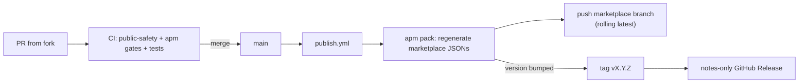

# Marketplace release process

How `agentic-survival-toolbox` is published.

## Summary

- `main` is the source of truth; contributions land via PRs that pass CI.
- On merge, `publish.yml` regenerates the marketplace output and pushes it to a
  dedicated `marketplace` branch (rolling "latest").
- Versioned releases are anchored by `v*` git tags, created when the
  marketplace `version` changes.



## How it works

1. **PR** — a contributor (human or agent) opens a PR against `main`. CI runs
   `scripts/check-public-safety.sh`, `apm marketplace check`,
   `apm pack --check-versions --check-clean --dry-run`, the skill audit, and any
   tests under `tests/`.
2. **Merge** — `publish.yml` runs the release gates and
   `apm pack --check-versions --strict-metadata`, regenerating
   `.claude-plugin/marketplace.json` and `.github/plugin/marketplace.json`.
3. **Marketplace branch** — the regenerated tree is committed to the
   `marketplace` branch and pushed; a compare-and-swap check aborts early if the
   branch moved, and git's non-fast-forward rejection is the final guard (a race
   fails the run rather than losing an update). When nothing changed, no commit
   is made.
4. **Tag + release** — when the version changed, the workflow pushes the
   `vX.Y.Z` tag (per `marketplace.build.tagPattern: "v{version}"`) and creates
   the notes-only GitHub Release itself. `publish.yml` is the single owner of
   both steps; there is no separate release workflow. Both are idempotent: an
   existing tag skips tag creation, and the release is only created when the
   tag is new.

   Tags pushed by hand outside this workflow do not get a release
   automatically. Re-running `publish.yml` is not required; create one for the
   existing tag with:

   ```bash
   gh release create vX.Y.Z --generate-notes
   ```

No `zip` or `sha256sum` artifacts are produced.

## How versioning works

- Semver, with the skill `description` as the API — see `CONTRIBUTING.md`.
- The tag derives from the marketplace (root `apm.yml`) `version` via
  `tagPattern: "v{version}"`; `--check-versions` (lockstep) enforces every
  package `version` matches it.
- Consumers resolve a version from these tags:

```yaml
dependencies:
  apm:
    - name: sdlc
      marketplace: agentic-survival-toolbox
      version: "^0.1.0"
```

or pin directly:

```yaml
dependencies:
  apm:
    - <owner>/agentic-survival-toolbox/plugins/sdlc#v0.1.0
```

Rolling latest pins the `marketplace` branch:

```yaml
dependencies:
  apm:
    - <owner>/agentic-survival-toolbox/plugins/sdlc#marketplace
```

## Consumers

- APM: `apm marketplace add <owner>/agentic-survival-toolbox`
- Copilot CLI: `gh copilot marketplace add <owner>/agentic-survival-toolbox`

## References

- [CONTRIBUTING.md](../CONTRIBUTING.md)
- [AGENTS.md](../AGENTS.md)
- [APM manifest schema](https://microsoft.github.io/apm/reference/manifest-schema/)
