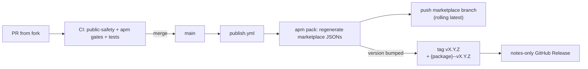

# Marketplace release process

How `agentic-survival-toolbox` is published.

## Summary

- `main` is the source of truth; contributions land via PRs that pass CI.
- On merge, `publish.yml` regenerates the marketplace output and pushes it to a
  dedicated `marketplace` branch (rolling "latest").
- Versioned releases are anchored by `v*` git tags, created when the
  marketplace `version` changes. Each release also publishes one
  `{package}--v{version}` tag per package, because that is the tag `apm install`
  resolves a marketplace version range against (see
  [ADR-0002](adr/0002-publish-per-package-release-tags.md)).



## How it works

1. **PR** — a contributor (human or agent) opens a PR against `main`. CI runs
   `scripts/check-public-safety.sh`, `apm marketplace check`,
   `apm pack --check-versions --check-clean --dry-run`, the skill audit, and any
   tests under `tests/`.
2. **Merge** — `publish.yml` runs the release gates and
   `apm pack --check-versions --strict-metadata`, regenerating
   `.claude-plugin/marketplace.json` and `.github/plugin/marketplace.json`.
3. **Marketplace branch** — the regenerated tree is committed to the
   `marketplace` branch and pushed; a compare-and-swap check aborts early if the
   branch moved, and git's non-fast-forward rejection is the final guard (a race
   fails the run rather than losing an update). When nothing changed, no commit
   is made.
4. **Tag + release** — when the version changed, the workflow pushes two tag
   families from the same commit and creates the notes-only GitHub Release
   itself. `publish.yml` is the single owner of both steps; there is no separate
   release workflow and no `release.yml`.

   - `vX.Y.Z` is the release anchor (`marketplace.build.tagPattern: "v{version}"`)
     and what the GitHub Release is keyed on.
   - `{package}--vX.Y.Z`, one per entry in `marketplace.packages`, is what
     `apm install` resolves a marketplace `version` range against. The packed
     marketplace entry for a local package source carries no tag pattern, so
     without this tag a range such as `^0.1.0` fails with
     `No tag matching version`.

   `scripts/release_tags.py` derives both families from the root `apm.yml`
   (`--plan`); the same run then asserts they point at the same commit
   (`--check`) and installs the package into a scratch repository to prove the
   consumer path works.

   Tag creation is idempotent — an existing tag is left alone. Release creation
   is keyed on the tag, not on the push, so it converges: if `gh release create`
   failed after the tag push, or the release was deleted to regenerate its
   notes, the next `publish.yml` run creates it. A tag pushed by hand gets its
   release on the next merge that sets `apm.yml` `version` to that tag, or
   immediately with:

   ```bash
   gh release create vX.Y.Z \
     --repo <owner>/agentic-survival-toolbox \
     --title vX.Y.Z \
     --generate-notes
   ```

No `zip` or `sha256sum` artifacts are produced.

## Why there is no separate release workflow

A `release.yml` triggered on `push: tags: ["v*"]` cannot run for the tags this
pipeline creates: a tag pushed with `GITHUB_TOKEN` does not trigger further
workflows, so it would only fire for hand-pushed tags — duplicating logic
`publish.yml` already runs, on a path nothing else exercises.

Making that workflow the sole owner instead would need either `actions: write`
granted to `publish.yml` for a `workflow_dispatch` handoff, or a long-lived
token or App credential so the tag push cascades. Both trade a single run that
owns the whole flow for a second, asynchronous failure surface, plus a secret to
rotate in the token case. Decided in #7; recorded in
[ADR-0001](adr/0001-publish-workflow-owns-releases.md).

## How versioning works

- Semver, with the skill `description` as the API — see `CONTRIBUTING.md`.
- The tag derives from the marketplace (root `apm.yml`) `version` via
  `tagPattern: "v{version}"`; `--check-versions` (lockstep) enforces every
  package `version` matches it.
- Consumers resolve a version from these tags; a range such as `^0.1.0` matches
  the `{package}--v{version}` tags, so it keeps working across patch and minor
  releases. Releases published before the alias tags existed can be backfilled
  once with `python3 scripts/release_tags.py --backfill` (add `--apply` to
  create the tags, then push them). That backfill is the one deliberate case
  where a tag is pushed by hand rather than by `publish.yml`, which is why it is
  a documented one-off instead of part of the release flow.

A diverged alias tag shows up as `<alias> points at abc1234, but vX.Y.Z points
at def5678` from the `--check` step. The repair is to delete the alias tag and
re-run the release: `git push --delete origin <alias>`, then rerun `publish.yml`
(or merge a new release). The workflow only creates tags that do not exist, so
re-pushing the release will restore it at the right commit.

```yaml
dependencies:
  apm:
    - name: sdlc
      marketplace: agentic-survival-toolbox
      version: "^0.1.0"
```

or pin directly:

```yaml
dependencies:
  apm:
    - <owner>/agentic-survival-toolbox/plugins/sdlc#v0.1.0
```

Rolling latest pins the `marketplace` branch:

```yaml
dependencies:
  apm:
    - <owner>/agentic-survival-toolbox/plugins/sdlc#marketplace
```

## Consumers

- APM: `apm marketplace add <owner>/agentic-survival-toolbox`
- Copilot CLI: `copilot plugin marketplace add <owner>/agentic-survival-toolbox`,
  then `copilot plugin install sdlc@agentic-survival-toolbox`

## References

- [CONTRIBUTING.md](../CONTRIBUTING.md)
- [AGENTS.md](../AGENTS.md)
- [APM manifest schema](https://microsoft.github.io/apm/reference/manifest-schema/)
